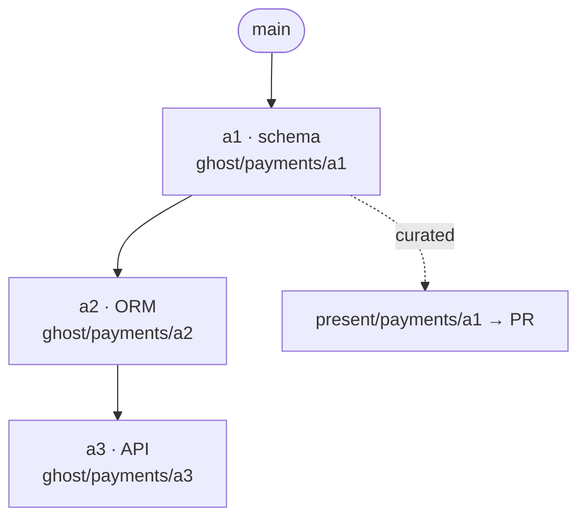
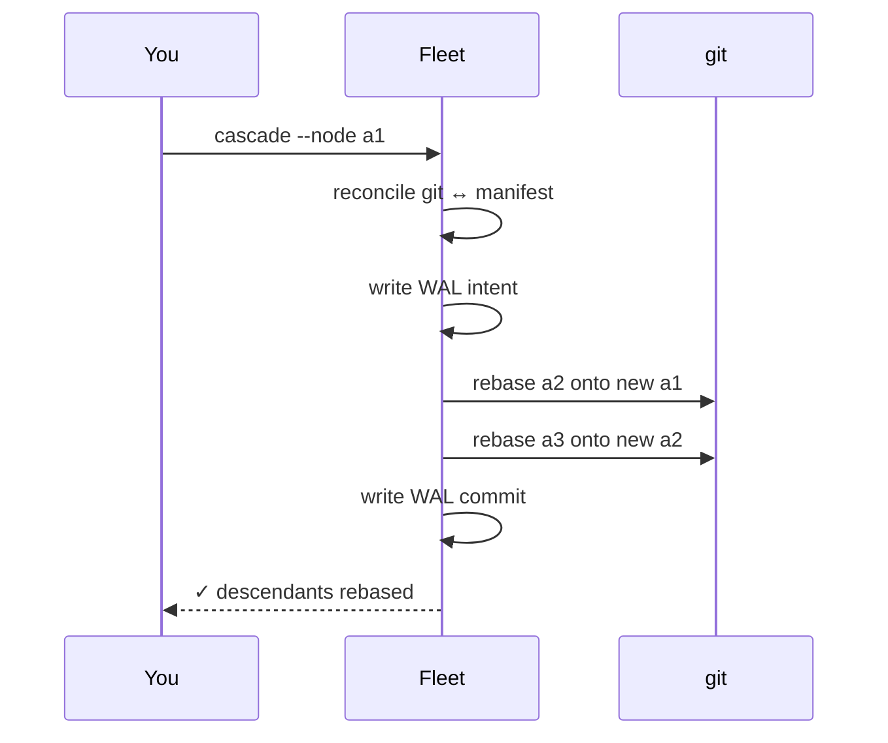
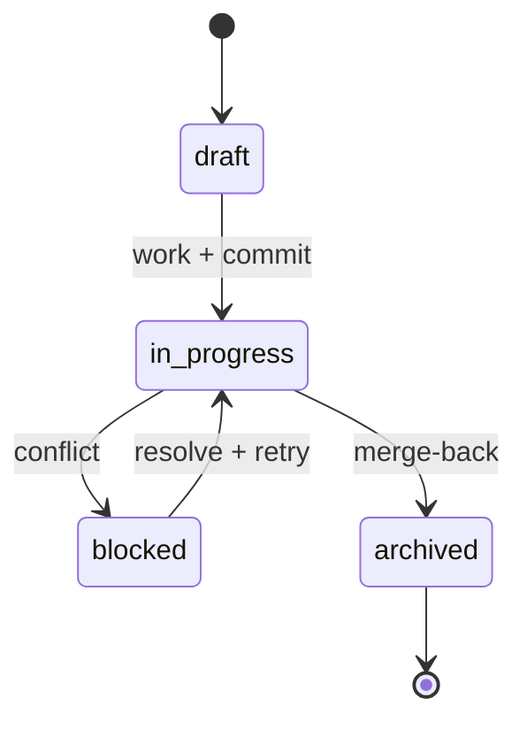

# Fleet

**Stacked git branches without the rebase pain.**

Fleet manages multi-node feature branches — stacks, decision forks, and build artifacts — as a single directed graph. Change a branch near the bottom of a stack and Fleet rebases everything above it in one deterministic pass. Every destructive step is previewed first and journaled to a write-ahead log, so a crash mid-rebase never leaves you guessing.

```bash
fleet cascade --feature payments --node a1 --dry-run   # see what moves
fleet cascade --feature payments --node a1             # move it
```

---

## Why Fleet

Stacked development breaks down the moment a base branch changes. You rebase `a2` onto the new `a1`, then `a3` onto the new `a2`, then discover `a4` conflicts — and you've lost track of which branch points where. Fleet holds the graph for you:

- **One cascade, not N rebases.** Update a base node; all descendants rebase in topological order.
- **Clean history on demand.** Curate messy work branches into logical commits for review, then squash them back onto `main` when the PR lands.
- **Crash-safe by construction.** A write-ahead log records intent before every mutation. Interrupt any operation and Fleet replays or rolls back to a valid state on next run.
- **Nothing moves without a preview.** Destructive operations require a dry-run and confirmation.

Fleet is single-writer and CLI-first. It wraps `git` and `gh`, keeps its state in a plain YAML manifest, and never touches `main`.

---

## Install

Requirements: Python 3.9+, `git`, and [`gh`](https://cli.github.com/) for PR integration.

```bash
git clone https://github.com/tusharpandey13/fleet.git
cd fleet
make deps          # installs test/runtime deps offline from vendor/wheels
```

Run the CLI:

```bash
python scripts/fleet.py --help
```

---

## Quickstart

Given a feature graph, cascade a change up the stack, publish a clean PR, then squash the base node back onto `main`.

```bash
# Preview then cascade descendants of the base node
fleet cascade --feature payments --node a1 --dry-run
fleet cascade --feature payments --node a1

# Build a curated presentation branch and open/update its PR
fleet publish --feature payments --node a1

# After the PR merges, squash a1 onto main and re-parent its children
fleet merge --feature payments --node a1 --dry-run
fleet merge --feature payments --node a1

# Inspect the graph at any time
fleet status --feature payments
```

The graph itself lives in `~/.fleet/<feature>/manifest.yaml` (see [references/MANIFEST-FORMAT.md](./references/MANIFEST-FORMAT.md)). `fleet init` scaffolds the feature directory; seed the node graph in the manifest before running graph operations. See [EXAMPLES.md](./EXAMPLES.md) for full walkthroughs including decision variants, conflict recovery, and force-push lease handling.

> **Status:** the graph-authoring intents (plan / materialize / work) are defined in the [skill spec](./SKILL.md) and reachable through the natural-language interface, but are not yet exposed as direct subcommands. The working CLI surface is the eight subcommands listed under [Commands](#commands).

---

## How it works

Fleet models your feature as a DAG of nodes. Each node owns a **ghost branch** (Fleet-managed working branch) and, optionally, a **presentation branch** (curated for review).



When you cascade from a node, Fleet parks affected worktrees, rebases every descendant in dependency order, then restores the worktrees:



A node moves through a simple lifecycle:



---

## Core concepts

| Concept | What it is |
|---------|------------|
| **Node** | A unit in the feature graph: a `feature` (branch on a stack), a `decision` (fork of alternative implementations), or an `artifact` (build output tracked for staleness). |
| **Ghost branch** | Fleet's working branch for a node (`ghost/<feature>/<node>`). Treat as read-only; Fleet rebases it. |
| **Presentation branch** | A curated branch (`present/<feature>/<node>`) built by replaying selected commits onto `main` for a clean PR. |
| **Manifest** | The canonical graph state in `~/.fleet/<feature>/manifest.yaml`. |
| **Write-ahead log** | Append-only `~/.fleet/<feature>/wal.jsonl` recording intent before each mutation, for crash recovery and audit. |

---

## Commands

| Command | Purpose | Safety |
|---------|---------|--------|
| `init` | Initialize a feature | Safe |
| `status` | Render the DAG and node states | Read-only |
| `cascade` | Rebase descendants of a node | Destructive · dry-run + confirm |
| `merge` | Squash a node onto `main`, re-parent children | Destructive · dry-run + confirm |
| `publish` | Build a presentation branch and open/update a PR | Destructive · force-push with lease |
| `reconcile` | Recompute manifest derivables from git | Read-only |
| `dryrun` | Preview any operation's impact | Read-only |
| `classify` | Map a natural-language phrase to an intent | Read-only |

Fleet also accepts natural-language phrasing (e.g. *"merge a1 back to main"*), classified into one of eleven intents. Low-confidence or ambiguous phrasing triggers an explicit confirmation prompt before anything destructive runs.

---

## Safety model

Fleet is designed so that no single command can silently corrupt your branches:

- **Dry-run gate.** `cascade`, `merge`, `publish`, and decision resolution print exactly which commits move and which worktrees park before executing.
- **Confidence threshold.** Natural-language intents below 0.7 confidence, or ambiguous node matches, require you to confirm.
- **Force-push with lease.** `publish` uses `--force-with-lease`. If a reviewer pushed to the presentation branch, Fleet stops and offers to incorporate, discard, or resolve manually.
- **Topological ordering.** Merge-back refuses to run out of order, so a child never re-parents onto a node that hasn't landed yet.
- **`main` is never modified.** Fleet only reads `main` to compute merge bases.

> **Note on recovery:** if a cascade or merge is interrupted, Fleet finds the unpaired WAL entry on next run and offers to replay the operation (idempotent) or roll back to the pre-operation refs. Review the proposed action before confirming — rollback restores branch pointers to their prior SHAs.

Error conditions surface as stable `FLEET_NNN` codes with recovery steps; see [references/ERROR-CODES.md](./references/ERROR-CODES.md).

---

## Performance

| Operation | Target |
|-----------|--------|
| Cascade (10 descendants) | < 10s |
| Merge-back | < 5s |
| Publish | < 3s |
| Status / reconcile | < 500ms |

All operations are idempotent: re-running a completed cascade, merge, or publish is a no-op guarded by pre-image checks in the WAL.

---

## Project layout

```
scripts/          Python state core + Bash git/gh wrappers
  fleet.py          CLI entry point
  fleet_manifest.py WAL, lock, reconcile, cascade, merge,
  fleet_*.py        present, decision, nli, dryrun, worktree
schemas/          manifest YAML schema
references/        ERROR-CODES, MANIFEST-FORMAT, WAL-FORMAT
tests/            pytest (unit) + bats (git integration)
vendor/wheels/    pinned wheels for offline, reproducible installs
SKILL.md          full skill reference
EXAMPLES.md       task-oriented walkthroughs
```

---

## Development

```bash
make deps          # offline install from vendor/wheels
make test          # pytest + bats (208 tests)
make test-py       # pytest only (no bats toolchain needed)
make deps-online   # refresh vendor/wheels from the package mirror
```

The test suite runs 164 pytest cases (Python state logic) and 44 bats cases (real git/`gh` integration). `make test` disables GPG commit signing for the bats sandbox so integration commits don't block on a passphrase prompt.

To refresh the vendored wheelhouse for a new platform or Python version, run `make deps-online` on that platform and commit the resulting wheels.

---

## Limitations

- **Single-writer.** One Fleet process per feature; coordinate multi-person work through separate features.
- **Decision variants are experimental.** Enable with `experimental: true` in the manifest.
- **CLI only.** Natural-language classification is provided; there is no GUI.

---

## License

Proprietary.
